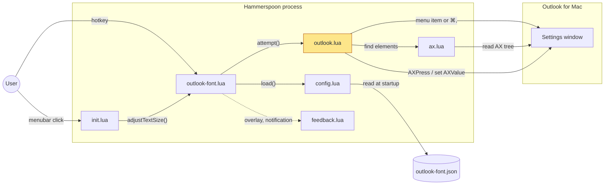

# outlook-fontsize-shortcuts


Keyboard shortcuts for changing text display size in Outlook for Mac, with support for both New and Legacy Outlook via Hammerspoon.

> _Claude was used to polish and proof-read the code and documentation of this repository._

<details>
<summary>Status and limitations</summary>

**Project status: archived independent automation project.** I developed this
Hammerspoon configuration independently alongside my main professional work. The
repository is no longer actively maintained and remains available as a starting point
to adapt, rather than a ready-to-use, supported Outlook product. Outlook's interface,
localization and macOS permissions can change. Review the configuration and test
shortcuts and settings on your own system before relying on them; responsibility for
any adaptation and use remains with you.

</details>

| Shortcut | Action |
|----------|--------|
| `Ctrl+Alt+Cmd+G` | Increase text size |
| `Ctrl+Alt+Cmd+K` | Decrease text size |
| `Ctrl+Alt+Cmd+T` | Toggle between increase and decrease |

Use it to avoid digging through Outlook settings every time you want larger or smaller interface text.

## How it works

Everything runs inside the Hammerspoon process; there is no server or daemon. A shortcut opens Outlook's own settings window, moves its text-size control one step through the macOS Accessibility API, and closes the window again.

Which parts are involved, and how do they reach Outlook?



`init.lua` is the user's Hammerspoon config: it loads the module, binds the hotkeys through `bindHotkeys()` and builds the menubar item. `outlook-font.lua` owns the policy: one change at a time (busy guard), activating Outlook, retries and the toggle direction. `outlook.lua` does one attempt against Outlook's UI, using the tree searches in `ax.lua`; it decides New vs Legacy Outlook from which menu entry opened the settings window. Nothing is stored between runs except what is in `outlook-font.json`; the toggle direction lives in memory until Hammerspoon reloads.

The step-by-step flow of a single shortcut, including retries and size limits, is in [docs/modes.md](docs/modes.md).

### Code map

| Path | Responsibility |
|------|----------------|
| [`init.lua`](init.lua) | Example `~/.hammerspoon/init.lua`: loads config, binds hotkeys, menubar item, success notification |
| [`outlook-font.lua`](outlook-font.lua) | Public API (`adjustTextSize`, `toggleTextSize`, `bindHotkeys`, `loadConfig`), busy guard, retries, toggle state |
| [`outlook_font/outlook.lua`](outlook_font/outlook.lua) | One attempt: find Outlook, open settings, detect New/Legacy, press button or move slider, close window |
| [`outlook_font/ax.lua`](outlook_font/ax.lua) | Depth-first searches over the Accessibility tree (by role, by text, button groups) |
| [`outlook_font/config.lua`](outlook_font/config.lua) | Built-in defaults, JSON-with-comments parsing, validation of `outlook-font.json` |
| [`outlook_font/feedback.lua`](outlook_font/feedback.lua) | Notifications and the debounced on-screen overlay |
| [`test/attempt_test.lua`](test/attempt_test.lua) | Plain-Lua tests with fake Hammerspoon and Accessibility objects |

## Supported Outlook versions

New Outlook and Legacy Outlook are both supported and detected automatically.

More on how each is handled: [docs/modes.md](docs/modes.md)

## Prerequisites

- macOS
- Outlook for Mac installed and signed in
- [Hammerspoon](https://www.hammerspoon.org/)
- Accessibility permission for Hammerspoon in `System Settings -> Privacy & Security -> Accessibility`

Install Hammerspoon with Homebrew if needed:

```bash
brew install hammerspoon
```

## Install

If you already have `~/.hammerspoon/init.lua`, merge this repo's `init.lua` changes instead of overwriting the file; `cp -n` below skips copying `init.lua` when one already exists.

```bash
git clone https://github.com/sebastianspicker/outlook-fontsize-shortcuts.git
cd outlook-fontsize-shortcuts
cp -n init.lua ~/.hammerspoon/
cp outlook-font.lua ~/.hammerspoon/
cp -R outlook_font ~/.hammerspoon/
cp -n outlook-font.json ~/.hammerspoon/outlook-font.json   # optional overrides; -n keeps an existing file
```

When upgrading, copy `outlook-font.lua` and `outlook_font/` again and re-merge any `init.lua` changes. A leftover `outlook_font/util.lua` from older versions is unused and can be deleted.

Reload Hammerspoon with `Ctrl+Alt+Cmd+R` or from its menubar icon.

## Usage

Default shortcuts:

- `Ctrl+Alt+Cmd+G`: increase text size
- `Ctrl+Alt+Cmd+K`: decrease text size
- `Ctrl+Alt+Cmd+T`: toggle between increase and decrease

You can also use the Hammerspoon menubar item for mouse-driven control.

## Configuration

`outlook-font.json` next to your `init.lua` (in Hammerspoon's config folder, normally `~/.hammerspoon/`) is optional. It accepts JSON with `//` and `/* */` comments. Keys you leave out keep their built-in defaults, which are defined in `outlook_font/config.lua`. Invalid values are reset to their defaults, and a notification lists them.

| Key | Default | Purpose |
|-----|---------|---------|
| `delays.activate` / `waitInterval` / `timeout` | `0.1` / `0.05` / `3` | Seconds after activating Outlook / polling interval / wait limit for windows and panes |
| `retry.attempts` / `interval` | `2` / `0.2` | Retries after the first attempt / pause between them |
| `overlayDuration`, `showOverlay` | `1.2`, `true` | On-screen overlay after a change |
| `hotkeys.increase` / `decrease` / `toggle` | `ctrl+alt+cmd` + `g` / `k` / `t` | `{ "mods": [...], "key": "x" }`; set `toggle` to `false` to disable it |
| `appNames` | `["Outlook", "Microsoft Outlook"]` | Fallback app names if the bundle id lookup fails |
| `settingsMenu`, `preferencesMenu` | `Outlook > Settings…`, `Outlook > Preferences…` | Menu paths for New and Legacy Outlook, tried first; ⌘, is sent if neither exists |
| `headerLabels`, `generalLabels`, `labelTexts` | English, German, French, Spanish | Localized texts used to find the settings controls |
| `overlayText.larger` / `smaller` | `"Larger"` / `"Smaller"` | Overlay text; also matched against New Outlook's size-button titles |

Notes:

- Arrays replace the defaults instead of extending them. To add a language, repeat the default entries as well.
- If you change `overlayText`, New Outlook's size buttons may no longer match by title. In that case the buttons are picked by position: last for larger, first for smaller.
- If `hotkeys.increase` or `hotkeys.decrease` is invalid, all three hotkeys fall back to their defaults. A key name Hammerspoon does not know is reported in a notification and that hotkey stays unbound.

The repo's [`outlook-font.json`](outlook-font.json) lists the commonly tuned keys with their default values.

If you are moving from an older legacy-only setup, see [docs/migration-from-legacy.md](docs/migration-from-legacy.md).

## Troubleshooting

| Symptom | Fix |
|---------|-----|
| Hotkeys do nothing | Confirm Hammerspoon is running, then re-check Accessibility permissions and reload the config. |
| Timeout waiting for the Outlook window | Increase `delays.timeout` in `outlook-font.json`. |
| Timeout although Outlook's Settings window is open | Close the Settings window and press the shortcut again. |
| Legacy behavior used to rely on `right_arrow_count` | This repo no longer uses that setting; see the migration guide. |
| Buttons or slider are not found | Outlook's UI or language probably changed. Inspect it with Accessibility Inspector, then add the visible texts to `headerLabels`, `generalLabels` or `labelTexts`. |

## Development

The code targets Lua 5.4, the version Hammerspoon embeds. You need a `luarocks` configured for Lua 5.4 and [StyLua](https://github.com/JohnnyMorganz/StyLua).

```bash
make test    # plain-Lua tests with fake Hammerspoon/Outlook objects; needs only `lua`
make tools   # installs luacheck into ./.luarocks
make check   # fmt-check + lint + test
```

## Security

See [SECURITY.md](SECURITY.md).
