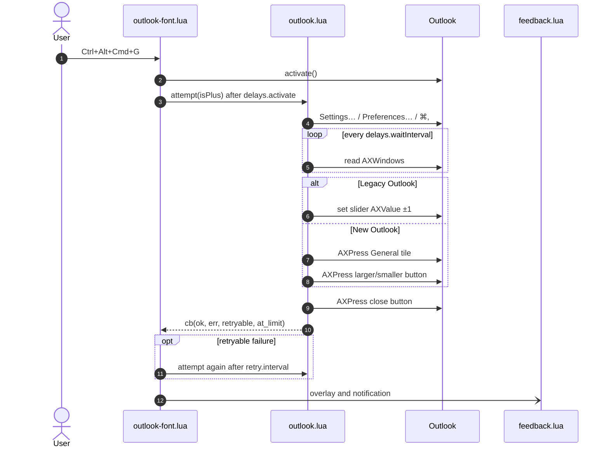

# Outlook Versions

`outlook-fontsize-shortcuts` drives New and Legacy Outlook through one runtime and detects the version automatically.

## Detection

The way the settings window was opened decides which version is handled:

- The `settingsMenu` entry (`Outlook > Settings…`) means New Outlook. The `General` tile is selected, the `Text display size` controls are awaited, and the larger or smaller button is clicked.
- The `preferencesMenu` entry (`Outlook > Preferences…`) means Legacy Outlook. The font-size slider is moved one step toward smaller or larger text.
- If neither menu entry exists (for example in a translated menu), `⌘,` opens the settings window, and a slider in it means Legacy Outlook; otherwise it is handled as New Outlook.

## What happens on each shortcut

What happens between pressing `Ctrl+Alt+Cmd+G` and the overlay appearing?

Steps 2–3 run in [`outlook-font.lua`](../outlook-font.lua) (`adjustTextSize` → `start_change`); a second shortcut pressed while one is running is ignored. Steps 4–10 are `attempt` in [`outlook_font/outlook.lua`](../outlook_font/outlook.lua): the polling loop (5) waits for a new window that looks like Settings, and the branch (6–8) is `legacy_step` or `new_outlook_step` + `press_size_button`. The callback (10) carries whether a retry is safe; step 11 only happens on retryable failures. On success the overlay comes from `feedback.lua` and the notification from the `report` callback in [`init.lua`](../init.lua). The numbered list below spells out each rule.

1. Settings are opened with the `settingsMenu` entry, then the `preferencesMenu` entry. If neither exists (for example in a translated menu), `⌘,` is sent, which opens an app's settings in every language.
2. Only a window that appears after that is used, and only if it looks like Settings (slider, settings header or text-size label). If Settings is already open, close it first; otherwise the attempt times out.
3. In New Outlook, the `General` tile is found next to the settings header, or by its label (`generalLabels`). If neither can be pressed and the text-size controls are not already visible, the attempt fails.
4. The settings window is closed with its own close button. If it has none, or pressing it fails, `Cmd+W` is sent to Outlook only if the settings window is Outlook's focused window, so a mail window is never closed.
5. Failures before the size actually changes are retried up to `retry.attempts` times. These include a missing slider, General tile or buttons, and a click that Outlook rejected. Once the size has changed, or a click or slider move ended in an accessibility error that may have landed anyway, nothing is retried, so a shortcut never changes the size twice.
6. Waiting longer than `delays.timeout` for the window or the General pane ends the attempt without retrying.
7. At the smallest or largest size (the Legacy slider is at its end, or New Outlook's size button is disabled) nothing changes, and a notification says so. The toggle shortcut then goes the other way next time.

The legacy-only runtime that navigated with arrow keys (`right_arrow_count`) was replaced by this single Accessibility-driven runtime; see [migration-from-legacy.md](migration-from-legacy.md).
